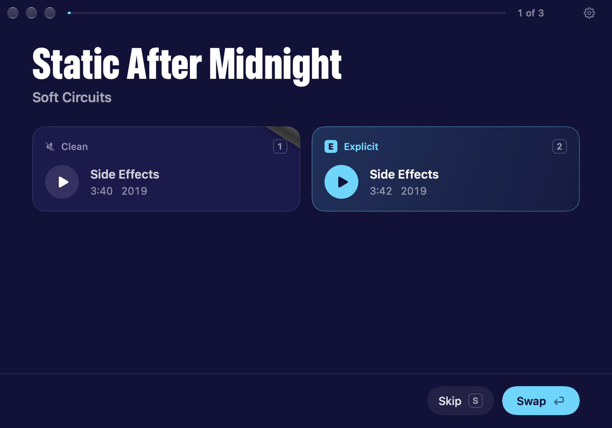

# Unbleep

Apple Music kept sneaking clean edits into my library, so I made Unbleep. It finds the clean tracks, lets you play both versions side by side, and swaps in the explicit ones you pick.

Download Unbleep from [Releases](https://github.com/Robdel12/unbleep/releases), unzip it, and drag it into Applications. You’ll need macOS 14 or later, an Apple Music subscription, and Sync Library turned on.

Click **Scan Library** to get started. Unbleep asks before removing clean copies and keeps the ones you’ve favorited or added to playlists.

[Build it in Xcode](docs/usage.md)
